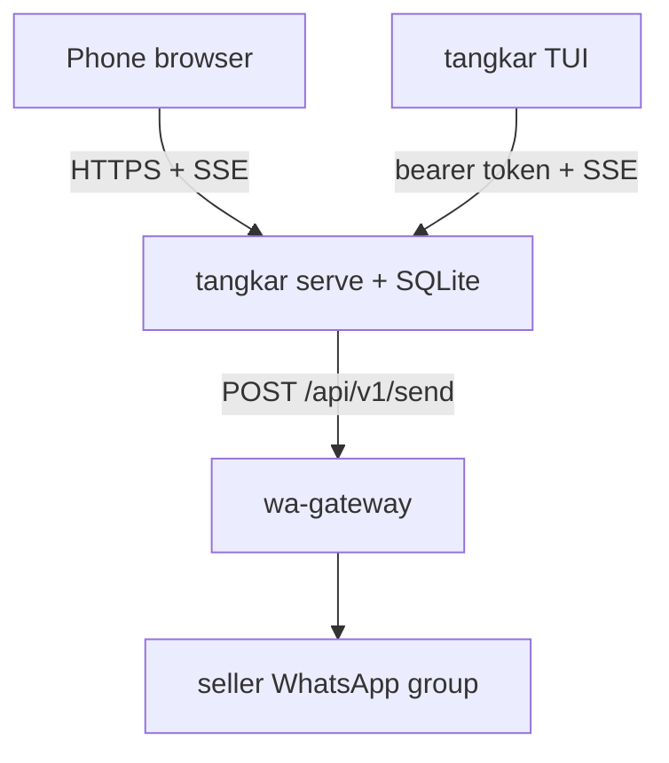
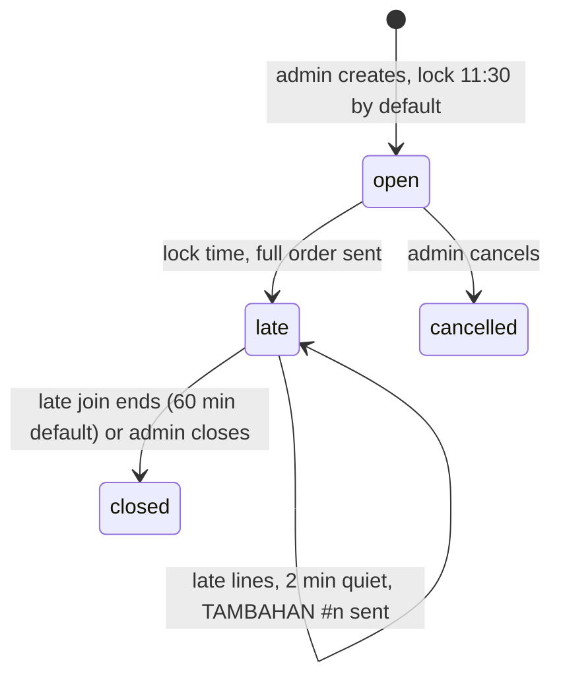

# tangkar

Order soto tangkar for the office without the recap. An admin opens an order, shares one link, everyone adds their own bowls, and at the lock time the recap goes to the seller's WhatsApp group by itself. Late orders still work: they go out as numbered `TAMBAHAN` messages.

One Go binary: `tangkar serve` runs the web app, the JSON API, the SSE streams, the clock and the WhatsApp sends on SQLite. `tangkar` (the TUI) is a client of the same API, so the browser and the terminal always show the same state.



## Order lifecycle



| Rule | Where it is enforced |
|---|---|
| One line is one bowl: `DAGING` or `CAMPUR`, 0 to 10 sate, a note of at most 10 characters | `internal/order`, plus `CHECK` constraints in SQLite |
| Notes keep only letters, digits, spaces and `. , - +` | `order.CleanText`; the pages only ever write user text with `textContent`, under a CSP without inline script |
| Hardlock: the clock is read inside the insert transaction | `store.AddLine` |
| A TAMBAHAN never goes out before the main order | `store.cutLate` waits for unsent messages |
| Failed sends retry 5 times (30s, 60s, ...), then wait for an admin | `store.PendingSends`, `R` in the TUI |
| Only `@bfi.co.id` Google accounts (verified, `hd` claim) and listed admins | `server.allowedEmail` |

## TUI

```sh
go install github.com/arisros/tangkar/cmd/tangkar@latest
tangkar
```

Or download a binary from the releases page. The first run prints a link and a code: open it, sign in with Google, check the code and press "Izinkan terminal". The token is kept in your user config directory (`tangkar logout` removes it). `TANGKAR_URL` points the TUI at another server.

| Key | Action |
|---|---|
| `d` / `a` (or `tab`) | DAGING / CAMPUR |
| `+` / `-` | sate |
| `n` | write a note, `enter` orders |
| `enter` | order |
| `↑` `↓` then `x` | delete one of your bowls (until it has been sent) |
| `c` | copy the order link (OSC 52, works over SSH) |
| admin: `n` on the list | new order |
| admin: `L` `T` `J` `X` `C` `R` | lock now, lock time, late join minutes, close late join, cancel, resend failed |

## Server configuration

| Env | Meaning |
|---|---|
| `TANGKAR_BASE_URL` | public URL, e.g. `https://tangkar.arisjirat.com` (`https` turns on secure cookies) |
| `TANGKAR_DB` | SQLite file, default `tangkar.db` (`/data/tangkar.db` in the image) |
| `GOOGLE_CLIENT_ID`, `GOOGLE_CLIENT_SECRET` | OAuth client; redirect URI is `<base>/auth/callback` |
| `TANGKAR_SESSION_SECRET` | at least 32 bytes |
| `TANGKAR_DOMAIN` | allowed Google Workspace domain, default `bfi.co.id` |
| `TANGKAR_ADMINS` | comma separated admin emails |
| `TANGKAR_WA_URL`, `TANGKAR_WA_TOKEN`, `TANGKAR_WA_TO` | wa-gateway base URL, tenant token, target JID (`...@g.us`) |
| `TANGKAR_WA_DRY_RUN=1` | log messages instead of sending |
| `TANGKAR_DEV_LOGIN=1` | local only: `/auth/dev?email=&name=` signs in without Google; refused with an `https` base URL |

## Local run

```sh
TANGKAR_DEV_LOGIN=1 TANGKAR_WA_DRY_RUN=1 TANGKAR_ADMINS=me@bfi.co.id \
TANGKAR_SESSION_SECRET=$(openssl rand -hex 32) go run ./cmd/tangkar serve
open "http://localhost:8080/auth/dev?email=me@bfi.co.id&name=Me"
```

Deployment manifests live in `arisros/homelab-platform` under `apps/tangkar/`.
