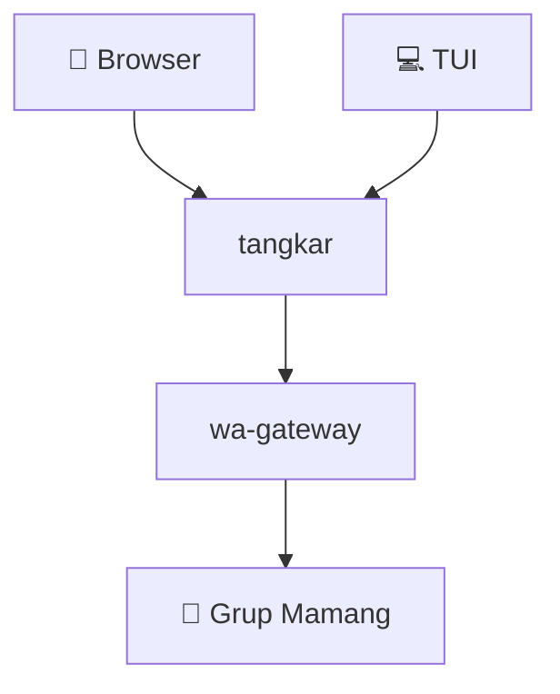
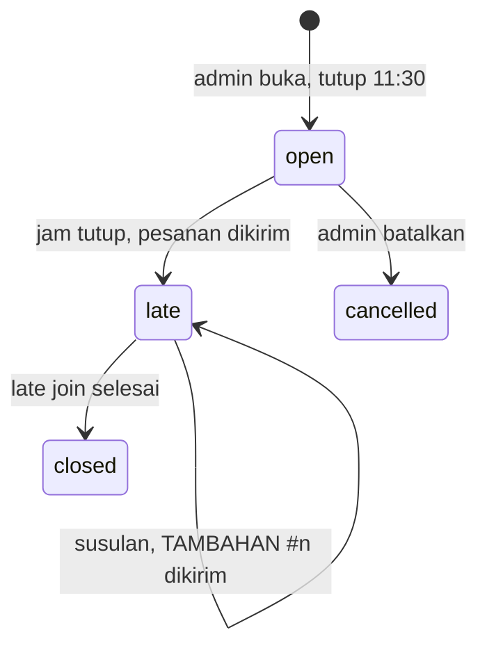

# 🍲 tangkar

Pesan soto tangkar bareng Kakak-kakak kantor. Satu link, semua isi sendiri, jam 11:30 langsung terkirim ke Mamang 🛵





## 💻 TUI

```sh
go install github.com/arisros/tangkar/cmd/tangkar@latest
tangkar
```

| Tombol | Fungsi |
|---|---|
| `d` / `a` | DAGING / CAMPUR |
| `+` / `-` | sate |
| `n` | catatan |
| `enter` | pesan |
| `x` | hapus pesanan |
| `c` | salin link |

## 🔧 Jalankan lokal

```sh
TANGKAR_DEV_LOGIN=1 TANGKAR_WA_DRY_RUN=1 TANGKAR_ADMINS=me@bfi.co.id \
TANGKAR_SESSION_SECRET=$(openssl rand -hex 32) go run ./cmd/tangkar serve
```

Buka `http://localhost:8080/auth/dev?email=me@bfi.co.id&name=Me`
