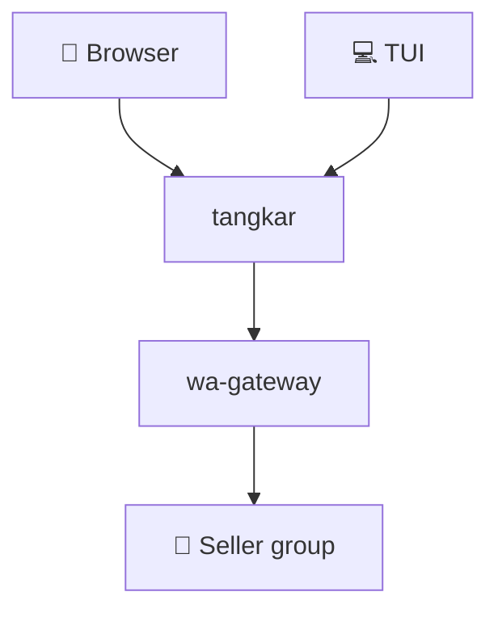
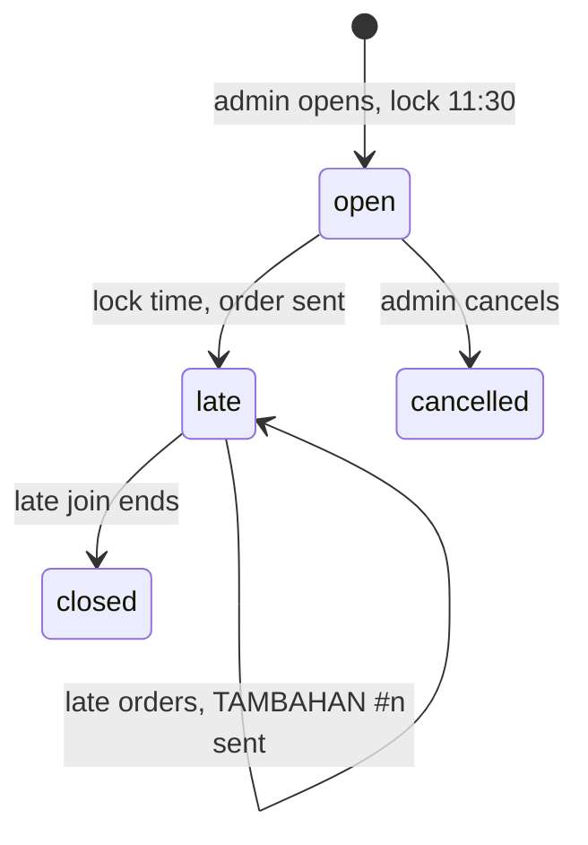

# 🍲 tangkar

Office soto tangkar orders in one shared link. Everyone adds their own bowls, and at the lock time the order goes to the seller's WhatsApp group automatically 🛵





## 💻 TUI

```sh
go install github.com/arisros/tangkar/cmd/tangkar@latest
tangkar
```

| Key | Action |
|---|---|
| `d` / `a` | DAGING / CAMPUR |
| `+` / `-` | sate |
| `n` | note |
| `enter` | order |
| `x` | remove a bowl |
| `c` | copy link |
